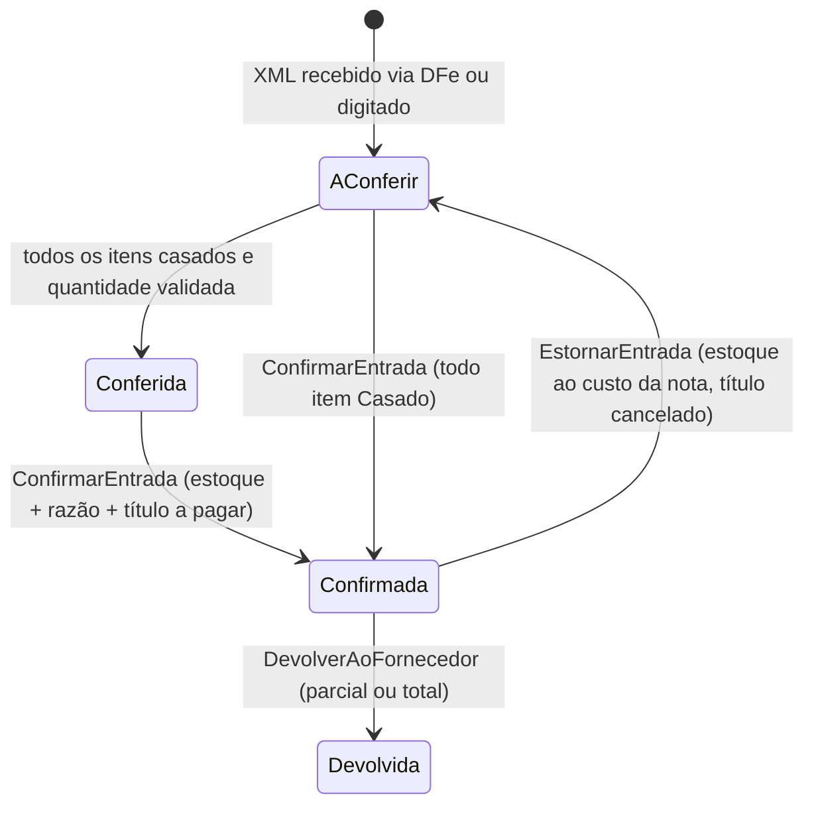
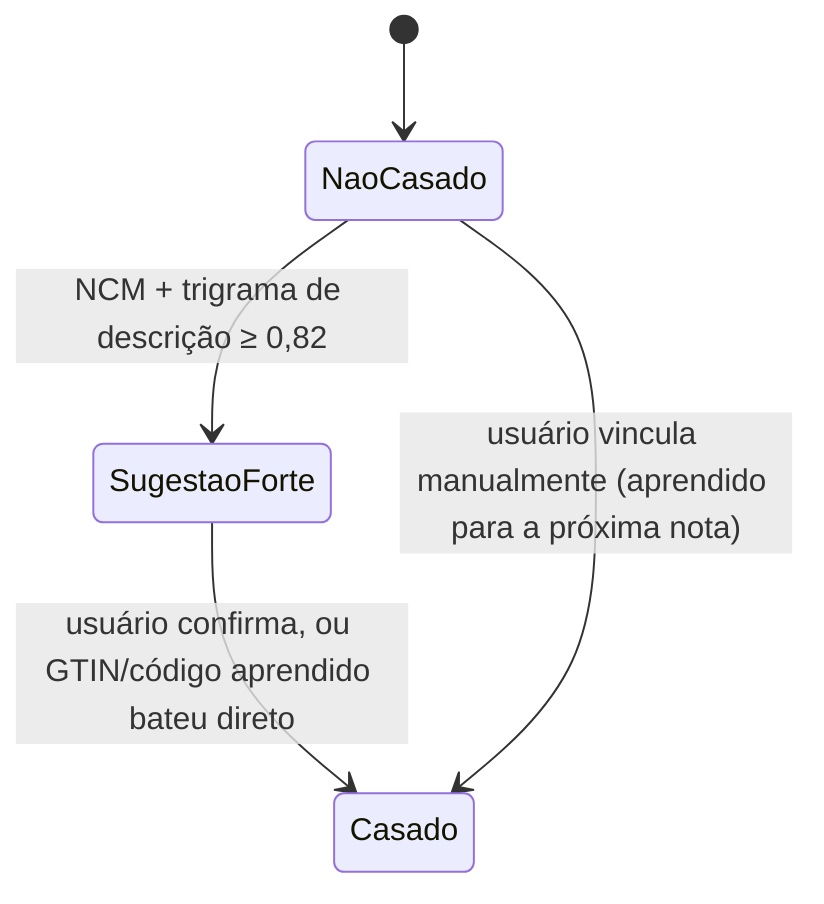

# Módulo Compras

> Da cotação à mercadoria conferida na prateleira, com o custo certo — frete e impostos rateados,
> sem exigir que o comprador redigite uma nota fiscal inteira.

## 1. Escopo

### Faz

- Mantém **cotação** com múltiplos fornecedores e comparação de preço/prazo.
- Mantém **pedido de compra** e seu acompanhamento de recebimento parcial.
- Processa **entrada por XML da NF-e** (via distribuição DFe do `PortaFiscal`) em "A conferir".
- Faz o **casamento de produto em cascata**: GTIN → código do fornecedor aprendido → NCM + trigrama
  de descrição → vínculo manual (que o sistema aprende e nunca mais pergunta).
- **Rateia** frete, seguro e despesas acessórias no custo unitário de cada item da nota.
- Processa **conferência** (quantidade recebida × pedida) e **devolução ao fornecedor**.

### Não faz

- **Não guarda saldo nem calcula custo médio.** Confirmar a entrada é um comando que chama
  `estoque.RegistrarEntrada`; o custo médio pós-entrada é responsabilidade de `estoque`.
- **Não assina nem transmite XML.** Recebe o XML já autorizado pela distribuição `DFe` da SEFAZ
  (`PortaFiscal::distribuicao_dfe`, pelo `sefaz-api`) ou por arquivo; emissão e assinatura são do
  provedor externo (ver [doc 10](../10-modulo-fiscal.md)).
- **Não paga o fornecedor.** Confirmar a entrada gera o `Titulo` a pagar por evento; a baixa é do
  `financeiro` — mesmo quando a compra já foi paga à vista (`pago_no_ato`), quem executa a baixa
  é `mod_financeiro::baixar_pagamento_comum`, chamado direto pela mesma transação; `compras` não
  reimplementa nem decide a lógica de baixa, só decide *se* ela acontece na hora.
- **Não decide o que comprar.** A sugestão de ponto de pedido vem de `estoque`; `compras` só
  transforma a sugestão (ou uma decisão manual) em cotação/pedido.

## 2. Submódulos

| id | nome | essencial | depende de | o que some da UI quando desligado |
|---|---|---|---|---|
| `pedido_compra` | Pedido de Compra | sim | — | Não pode ser desligado: é o agregado central. |
| `cotacao` | Cotação | não | `pedido_compra` | Etapa de cotação some; pedido é criado direto. |
| `entrada_xml` | Entrada por XML | não | `pedido_compra` | Só entrada manual digitada fica disponível. |
| `casamento_produto` | Casamento Automático | não | `entrada_xml` | Toda linha de nota exige vínculo manual, sempre. |
| `rateio` | Rateio de Despesas | não | `entrada_xml` | Frete/seguro somem do custo; ficam como despesa avulsa. |
| `devolucao` | Devolução ao Fornecedor | não | `entrada_xml` | Botão "Devolver" some da nota confirmada. |

## 3. Entidades

| Entidade | Campos principais | Observações |
|---|---|---|
| **Cotacao** | `id`, `empresa`, `data`, `estado`(`Aberta`,`Recebida`,`Decidida`,`Cancelada`), `fornecedor_vencedor` | |
| **ItemCotacao** | `id`, `cotacao`, `fornecedor`, `produto`, `quantidade`(Quantidade), `preco_unitario`(Preco), `prazo_entrega_dias`(Quantidade inteiro) | uma linha por fornecedor × produto cotado |
| **PedidoCompra** | `id`, `empresa`, `fornecedor`, `cotacao_origem`, `data`, `previsao_entrega`(Data), `condicao_pagamento`, `estado`(`Rascunho`,`Enviado`,`ParcialmenteRecebido`,`Recebido`,`Cancelado`), `total`(Dinheiro), `versao` | |
| **ItemPedidoCompra** | `id`, `pedido_compra`, `produto`, `quantidade`(Quantidade), `preco_unitario`(Preco), `quantidade_recebida`(Quantidade) | |
| **NotaEntrada** | `id`, `empresa`, `fornecedor`, `pedido_compra_origem`, `chave_acesso`(String, 44 dígitos), `numero`, `serie`, `data_emissao`(Data), `valor_produtos`, `valor_frete`, `valor_seguro`, `valor_outras_despesas`, `valor_total`(Dinheiro), `estado`(`AConferir`,`Conferida`,`Confirmada`,`Devolvida`), `versao` | |
| **ItemNotaEntrada** | `id`, `nota_entrada`, `produto_casado`, `codigo_fornecedor`, `descricao_fornecedor`, `ncm`, `quantidade`(Quantidade), `valor_unitario`(Preco), `valor_rateio`(Dinheiro), `custo_final_unitario`(Preco), `estado_casamento`(`NaoCasado`,`SugestaoForte`,`Casado`) | `custo_final_unitario` já inclui o rateio |
| **RegraCasamentoAprendida** | `empresa`, `fornecedor`, `codigo_fornecedor`, `produto`, `aprendido_em`(Instante) | `PRIMARY KEY(empresa, fornecedor, codigo_fornecedor)` |
| **DevolucaoFornecedor** | `id`, `empresa`, `nota_entrada_origem`, `fornecedor`, `data`, `motivo`, `valor_total`(Dinheiro), `estado`(`Solicitada`,`Concluida`) | |

## 4. Máquinas de estado





## 5. Comandos

| Comando | Permissão | Risco | O que faz | Erros possíveis |
|---|---|---|---|---|
| `CriarCotacao` | `compras.cotacao.criar` | Baixo | Ainda não implementado — cotação/pedido de compra formal ficaram para quando tiverem consumidor (esta versão vai direto da nota ao estoque, como o `gestao-raiz` faz) | — |
| `RegistrarPropostaFornecedor` | `compras.cotacao.editar` | Baixo | Ainda não implementado | `CotacaoDecidida` |
| `DecidirCotacao` | `compras.cotacao.decidir` | Médio | Ainda não implementado | — |
| `CriarPedidoCompra` | `compras.pedido.criar` | Baixo | Ainda não implementado | — |
| Tarefa `compras.buscar_notas_na_sefaz` ✅ (2026-10-26) | `compras.entrada.importar` | Baixo | As notas que a SEFAZ entrega ao CNPJ (distribuição `DFe`), **fora de transação**, como a transmissão da NFC-e (ver a nota abaixo). Chama `importar_nota_da_sefaz` por nota completa: interpreta o XML (`cardeal_fiscal::interpretar`), resolve/cadastra o fornecedor por CNPJ, roda o casamento em cascata por item (GTIN → regra aprendida → NCM+similaridade) e rateia frete/seguro/outras despesas | — |
| `ImportarDeNovoDaSefaz` ✅ (2026-10-26) | `compras.entrada.importar` | Baixo | A nota que chegou da SEFAZ e não importou (o XML ficou guardado) entra de novo, depois de cadastrar o que faltava | o erro da importação |
| `ImportarNotaDeArquivoXml` ✅ (não estava no spec original) | `compras.entrada.importar` | Baixo | Mesmo XML de NF-e de `importar_nota_da_sefaz`, mas lido de um arquivo local (a UI escolhe o arquivo via `rfd`; este comando só recebe o texto já em UTF-8) em vez de baixado da distribuição `DFe` — não depende de `PortaFiscal`, então **é** um `Comando` de despacho de verdade. Corpo compartilhado com `importar_nota_da_sefaz` (`importar_nota_interpretada`, `pub(crate)`): mesma resolução de fornecedor, cascata de casamento, rateio e idempotência por `(empresa, chave_acesso)` | `ChaveJaImportada` (idempotente: reimportar não duplica, devolve o relatório da nota existente) |
| `LancarNotaManual` ✅ (não estava no spec original) | `compras.entrada.importar` | Baixo | Compra sem nota fiscal formal — mesma cascata de casamento/rateio de `importar_nota_da_sefaz`, mas os itens vêm digitados (`ItemNotaManual`, com `codigo_barras` opcional para entrar na cascata por GTIN também) em vez de um XML, e `chave_acesso` fica `None` (o índice `UNIQUE` do SQLite trata múltiplos `NULL` como distintos, então não colide com a idempotência das notas importadas) | — |
| `DefinirPreferenciasCompras` ✅ (não estava no spec original) | `compras.entrada.preferencias` | Médio | Grava `PreferenciasCompras` — confirmação automática, geração de título a pagar, rateio por valor/peso, local padrão, `pago_no_ato_padrao` — a resposta desta versão ao pedido do usuário por "vários ajustes de preferências" e por "permitir gerar ou não registro automático no financeiro seja algo pago ou não" | — |
| `VincularProdutoManual` ✅ | `compras.entrada.conferir` | Baixo | Casa a linha e grava `RegraCasamentoAprendida` | `ItemNaoPertenceANota` |
| `CriarProdutoDoItem` ✅ (2026-10-13, `compras.criar_produto_do_item.v1`) | `compras.entrada.conferir` **e** `estoque.produto.criar` (`ctx.concede`) | Baixo | Item que não casou com nada: cria o produto (nome escolhido pelo usuário — a sugestão padronizada de `estoque.sugerir_nome_do_produto.v1`, possivelmente corrigida —, NCM e código de barras da nota, grupo opcional ou "Sem grupo", unidade `UN`) via `mod_estoque::criar_produto_de_compra_comum`, vincula o item, grava a `RegraCasamentoAprendida` e ensina ao dicionário DE/PARA de nomes o que a correção explica | `NotaJaConfirmada`, `SEM_PERMISSAO`, grupo inexistente |
| `RatearDespesas` | `compras.entrada.conferir` | Baixo | Ainda não é um comando separado — o rateio acontece dentro de `importar_nota_da_sefaz`, não como passo manual | `ReferenciaInvalida` |
| `ConferirQuantidade` | `compras.entrada.conferir` | Baixo | Ainda não implementado (não há `PedidoCompra` para comparar) | `QuantidadeDivergente` (aviso) |
| `ConfirmarEntrada` ✅ | `compras.entrada.confirmar` | Alto | Exige todo item `Casado`; `mod_estoque::registrar_entrada_comum` por item e, se a preferência (ou o campo `gerar_titulo_a_pagar`) mandar, `mod_financeiro::lancar_titulo_comum` — chamados **direto, na mesma transação** (não via despacho — `docs/contratos-internos.md` §7 regra 2). Quando `pago_no_ato` (campo do comando, ou a preferência `pago_no_ato_padrao`) também é verdadeiro, a mesma transação já dá baixa completa no título recém-criado com `mod_financeiro::baixar_pagamento_comum`, na data da confirmação — a compra paga à vista nunca aparece "em aberto" no Contas a Pagar. Quando as preferências permitem e a varredura de `verificar_notas_na_sefaz` já casou tudo por GTIN ou regra aprendida, isto roda sozinho (`confirmar_entrada_comum`, mesma função por trás do comando). **Parcelas (2026-10-20):** o título a pagar nasce com as parcelas da nota — as duplicatas do XML (`cobr/dup`, guardadas na importação em `compras_nota_parcela`) ou as do campo `parcelas` (vencimento e valor de cada; a tela preenche com as duplicatas, divide em N a cada X dias ou acrescenta). Sem nenhuma, uma parcela vencendo na emissão. As parcelas precisam somar o total da nota e não vencer antes da emissão; as usadas ficam gravadas na nota. Duplicatas que não fecham com o total viram **aviso** na importação (a nota não se confirma sozinha). Pago no ato ignora as parcelas: uma só, quitada | `ItemNaoCasado`, `NotaJaConfirmada`, `EstadoDeNotaInvalido`, `ParcelasNaoFecham`, `ParcelaInvalida` |
| `EstornarEntrada` ✅ (2026-10-20, `compras.estornar_entrada.v1`; prévia `compras.previa_estorno_entrada.v1`) | `compras.entrada.estornar` | Alto | Desfaz a entrada confirmada para corrigir (lição do `revertNoteImport` do `gestao-raiz`), numa transação: a mercadoria sai do estoque **ao custo da nota** (`mod_estoque::retirar_entradas_da_origem` — o custo médio volta ao que seria sem a entrada), o lançamento D Estoque / C Fornecedores é estornado e o título cancelado (`mod_financeiro::desfazer_titulo_da_origem_comum`), e a nota volta para `AConferir` com os itens casados como estavam — corrige-se o vínculo ou as parcelas e confirma de novo. **Recusa** se a mercadoria já não está toda no local (vendida, movida) e, se a conta já tem pagamento, exige `estornar_pagamento` (o pagamento é estornado e o dinheiro volta para a conta de onde saiu). Parcela renegociada bloqueia. Motivo ≥ 10 caracteres, que vai ao histórico do Razão. Nunca apaga | `EstadoDeNotaInvalido`, `MotivoDoEstornoCurto`, `EntradaComPagamento`, `EntradaJaConsumida`, `TituloComMovimento` |
| `DevolverAoFornecedor` ✅ (2026-10-27, `compras.devolver_ao_fornecedor.v1`; `compras.devolucoes_da_nota.v1`) | `compras.devolucao.criar` | Alto | Parte ou toda a mercadoria de uma nota **confirmada** volta, item a item (a nota pode voltar em várias devoluções). Numa transação: a mercadoria sai do estoque ao valor da compra, só se ainda está no local (`mod_estoque::devolver_parte_da_entrada`, com a mesma origem da entrada — o que voltou deixa de ser entrada viva); a conta a pagar da nota é **abatida** das parcelas em aberto, da que vence primeiro em diante (`mod_financeiro::abater_titulo_da_origem_comum`: D Fornecedores / C Estoque, sem caixa, sem juros); o que não couber (a conta já paga) vira **crédito com o fornecedor**, um título a receber dele (origem `compras_devolucao`). O valor de cada item é a parte dele no custo da nota (produto − desconto + frete/seguro/outras rateados + ST e IPI), na proporção; a última devolução do item leva o resto, e a soma fecha ao centavo. Devolvida toda, a nota vira `Devolvida`. A nota com devolução não se estorna mais (`NotaComDevolucao`). Motivo ≥ 10 caracteres (vai na NF-e). Sem aprovação em duas etapas (a spec previa `Solicitada` → `Concluida`): o comando é auditado | `EstadoDeNotaInvalido`, `DevolucaoVazia`, `DevolveMaisQueEntrou`, `MotivoDaDevolucaoCurto`, `DevolucaoMaiorQueOResto` (estoque) |
| `EmitirNfeDaDevolucao` ✅ (2026-10-27, `compras.emitir_nfe_da_devolucao.v1`) | `fiscal.emitir` | Médio | A NF-e de devolução (finalidade 4) da devolução: o compras junta a nota, os itens e o XML da compra e o `mod-fiscal` monta e põe na fila (`docs/modulos/fiscal.md` §7). A rejeitada se emite de novo por aqui, depois de corrigir (no mesmo número) | os da NF-e |

> **Nota (2026-09-13):** casamento por GTIN, importação por arquivo local e pago-no-ato
> entraram nesta rodada — ver o histórico de "Nota (2026-09-05)" abaixo para o que já vinha de
> antes. GTIN deixou de ser "fora desta fatia": `estoque_produto.codigo_barras` (GTIN,
> validado por dígito verificador) já existia em `mod-estoque`, então a cascata de casamento
> (`crate::casamento::casar`) ganhou o GTIN como primeira tentativa, antes da regra aprendida
> — `det/prod/cEAN` do XML (`cardeal_fiscal::ItemNfe::codigo_barras`, com o literal
> `"SEM GTIN"` da NF-e tratado como ausência) ou o `codigo_barras` opcional de
> `ItemNotaManual`. `ImportarNotaDeArquivoXml` fecha o pedido de "importação de notas de
> compra reto pro estoque" a partir de um arquivo — sem depender da SEFAZ estar disponível —
> reaproveitando o mesmo miolo (`importar_nota_interpretada`, `pub(crate)`) que
> `importar_nota_da_sefaz` já usava. `ConfirmarEntrada`/`PreferenciasCompras` ganharam
> `pago_no_ato`/`pago_no_ato_padrao` para "gerar ou não registro automático no financeiro seja
> algo pago ou não": quando ligado, a baixa é dada com `mod_financeiro::baixar_pagamento_comum`
> (novo, mesmo padrão de `lancar_titulo_comum` — chamável direto por outro módulo, na mesma
> transação, sem passar pelo despacho de `Comando`).
>
> **Nota (2026-09-05):** as linhas ✅ estão implementadas com teste de integração de ponta a
> ponta contra SQLite real (`crates/modulos/mod-compras/tests/importacao.rs`), com
> `cardeal_fiscal::FiscalSimulado` no lugar da SEFAZ real — os dois caminhos: confirmação
> totalmente automática (regra aprendida + preferências) e revisão manual
> (`VincularProdutoManual` + `ConfirmarEntrada`). `importar_nota_da_sefaz`/
> `verificar_notas_na_sefaz` não são `Comando` porque dependem de `PortaFiscal`
> (`cardeal-fiscal`), e `Ctx::porta()` — a forma de injetar uma porta dentro de um comando —
> ainda está listado como adiado em `docs/contratos-internos.md` §4; até lá, quem tem a
> porta em mãos chama a função direto, montando o `Ctx` com `cardeal_modkit::Ctx::de_sessao`
> (novo). `Manifesto::depende_de` declara `clientes`/`estoque`/`financeiro` — sem essas três
> ativas o módulo não sobe (o código chama `pub fn` delas incondicionalmente).

> **Nota (2026-10-26) — as notas que chegam pela SEFAZ (item 9 do doc 21).** A varredura que era
> uma função chamada por fora (`verificar_notas_na_sefaz`, dentro de uma transação) virou a tarefa
> `compras.buscar_notas_na_sefaz`, sobre as rotas novas do `sefaz-api` (distribuição, consulta por
> chave, manifestação). Lições do `gestao-raiz`, em produção: o **NSU nunca volta** (resposta ruim
> não grava NSU; a base guarda o maior); em dia ou com 656, a próxima consulta **só depois de uma
> hora**; uma rodada por vez por empresa — a vez é tomada **na base**, para dois terminais não
> consultarem juntos; documento que não importa **não trava a fila** (fica guardado com o XML e o
> motivo, e `ImportarDeNovoDaSefaz` tenta de novo); o resumo (`resNFe`) recebe a **Ciência da
> Operação** sozinho e a nota completa vem pela consulta por chave ou pelo NSU seguinte; ciência
> fora do prazo (596, 10 dias da emissão) pede o XML ao fornecedor. Aqui, além disso: o NSU é **por
> ambiente** (passar de homologação para produção não pula nota); nota de homologação não entra no
> estoque; o cancelamento pelo fornecedor tira a nota da espera, ou vira aviso se ela já entrou.
> O desktop busca sozinho (`compras_fundo`, a cada minuto confere se a hora chegou) e tem o botão
> "Buscar na SEFAZ". Ficaram para depois: as manifestações conclusivas (confirmação ao confirmar a
> entrada, desconhecimento), e conferir contra o Ambiente Nacional de homologação.

> **Nota (2026-09-15) — importação em lote e validação mais dura:** pedido explícito do
> usuário — a burocracia que sobrava era repetir "escolher arquivo → conferir → fechar" uma
> vez por XML quando uma entrega trazia várias notas. `ImportarNotaDeArquivoXml` continua
> igual (um XML por chamada, idempotente por chave de acesso); o que mudou é só a UI
> (`crates/cardeal-desktop/src/tela_compras.rs`): "Importar XML" agora usa `pick_files`
> (multi-seleção) em vez de `pick_file`, e um botão novo "Importar pasta" varre um diretório
> escolhido (`pick_folder`, sem descer em subpastas) atrás de todo `.xml` nele. Ambos chamam
> `importar_varios_xml`, que roda o comando um arquivo por vez e junta um resumo (quantas
> notas entraram, quantas precisam de revisão de casamento, quais falharam e por quê) — com
> um único arquivo o comportamento de antes se mantém (abre o dialog "Ver" da nota direto);
> com vários, só o resumo aparece, e o balcão escolhe da lista o que quer conferir. Reimportar
> uma pasta/seleção que já tinha entrado antes é seguro — a idempotência por chave de acesso
> garante que só as notas novas de fato entram.
>
> Endurecimento em `cardeal_fiscal::interpretar` (`crates/cardeal-fiscal/src/nfe.rs`): `qCom`
> zero ou negativo e `vUnCom` negativo agora são recusados (`ErroFiscal::XmlInvalido`) em vez
> de aceitos silenciosamente — a importação em lote reduz a chance de alguém abrir cada nota
> pra notar um XML anômalo, então o parser passou a barrar isso na entrada.

> **Nota (2026-10-13) — produto a partir da nota (lunno §5.6):** o item guarda agora o código de
> barras (`cEAN`) da nota (migração `compras` v3, `compras_item_nota_entrada.codigo_barras`), que antes
> só servia para casar e era descartado. Na conferência, o item "Não casado" ganha "Não está no
> catálogo? Criar produto novo": o nome vem sugerido pelo dicionário da empresa (ver
> `estoque.md`, "Padronização do nome"), o usuário corrige se quiser e escolhe o grupo. A nota
> seguinte do mesmo item casa sozinha (pelo código de barras e pela regra aprendida).

> **Nota (2026-10-13) — ICMS-ST, IPI e desconto da nota no custo:** o leitor da NF-e (`cardeal_fiscal`) passou
> a ler, por item, `vDesc`, `vICMSST` + `vFCPST` (o ST **cobrado nesta nota**; o `vICMSSTRet` retido antes
> fica de fora, já está no preço) e `vIPI`. O item guarda desconto e impostos (migração `compras` v4) e o custo
> que vai para o estoque passa a ser **bruto − desconto + rateio de despesas + ICMS-ST + IPI** — impostos que
> quem compra para revender não recupera. O total da nota passou a ser o que o fornecedor cobra (o `vNF`):
> **antes era só produtos + despesas, e o título a pagar saía menor que o boleto** em toda nota com ST ou IPI.
> Na conferência, cada item mostra de onde vem o custo.

> **Nota (2026-10-28) — ICMS-ST estimado pela MVA** (`mod_compras::st`, `compras.estimativa_de_st.v1`): o item
> casado com produto que tem MVA-ST e alíquota no perfil fiscal (o efetivo, herdado do grupo) e que chegou
> **sem** ST — nem cobrado nesta nota, nem retido antes (CST 10/30/60/70, CSOSN 201/202/203/500) — tem a
> antecipação estimada: base = valor da operação (produto − desconto + frete/seguro/outras + IPI) × (1 + MVA);
> na compra de outro estado (a UF da chave não é a da empresa), a **MVA ajustada** do Convênio ICMS 52/2017
> (`(1 + MVA) × (1 − interestadual) / (1 − interna) − 1`, com duas casas); ST = base × alíquota interna − o ICMS
> da origem (o destacado na nota, ou o valor × a alíquota de origem); nunca negativo. A conferência mostra item
> a item e quem confirma decide (`ConfirmarEntrada.incluir_st_estimado`): o ST entra no custo do item
> (`compras_item_nota_entrada.st_estimado`, migração v10) e vira a **guia a pagar ao estado** (título de origem
> `compras_st`, D Estoque / C Fornecedores — a baixa do financeiro debita o papel padrão; vencimento no dia 20
> do mês seguinte, o prazo mais comum, que se altera no financeiro). A nota com estimativa **não se confirma
> sozinha** (fica com o aviso). O estorno da entrada tira o ST do custo e cancela a guia. Lição do gestao-raiz:
> ST por MVA se detecta e vai para revisão humana — aqui a conta é feita, mas a decisão é de quem confere.

> **Nota (2026-10-20):** a tela só mostrava "Confirmar entrada" para nota `Conferida` — estado
> que nenhum comando alcança. Na prática, a nota que não se confirmava sozinha não tinha como
> ser confirmada pela tela. Agora a confirmação aparece na nota em conferência quando todo item
> tem produto (`ConfirmarEntrada` já aceitava `AConferir`).

## 6. Consultas

| Consulta | Permissão | Uso na UI | Índice que a sustenta |
|---|---|---|---|
| `NotasAConferir` | `compras.entrada.ver` | Fila "4 notas para conferir" no Pulso | `compras_nota_entrada(empresa, estado)` |
| `CotacoesAbertas` | `compras.cotacao.ver` | Painel de cotação | `compras_cotacao(empresa, estado)` |
| `PedidosPendentesDeRecebimento` | `compras.pedido.ver` | Painel de recebimento | `compras_pedido_compra(empresa, estado)` |
| `SugestaoDeCasamento` | `compras.entrada.conferir` | Tela de conferência | `compras_regra_casamento(fornecedor, codigo_fornecedor)` |
| `ParcelasDaNota` ✅ (2026-10-20) | `compras.entrada.ver` | As parcelas no "Confirmar entrada" | `compras_nota_parcela(nota, ordem)` |
| `PreviaDoEstornoDaEntrada` ✅ (2026-10-20) | `compras.entrada.ver` | O que o estorno faz: o que sai do estoque (e quanto há no local), a conta cancelada, o pagamento | movimentos da origem + `financeiro::situacao_do_titulo_da_origem` |
| `NotasDeEntradaDoMes` ✅ (2026-10-20, `compras.notas_do_mes.v1`) | `compras.entrada.ver` | O pacote do contador: as notas emitidas no mês (pela emissão, o dia em que a compra entra no Razão) com o fornecedor, a situação e o **XML original** | `compras_nota_entrada(empresa, data_emissao)` (varredura do mês) |
| `EntradasParaEscriturar` ✅ (2026-10-28, `compras.entradas_para_escriturar.v1`) | `compras.entrada.ver` | O SPED (EFD ICMS/IPI): as notas confirmadas (e as devolvidas depois) no mês da **entrada** — a confirmação, gravada em `data_entrada` (migração v11); a confirmada antes usa a emissão —, com o XML e o produto casado de cada item (nome, unidade, NCM, GTIN, CEST), e as que entraram sem XML. Difere do `NotasDeEntradaDoMes` (o mês da emissão, o do Razão): a EFD escritura pela data da entrada | `compras_nota_entrada(empresa, estado)` |
| `NotasNaSefaz` ✅ (2026-10-26, `compras.notas_na_sefaz.v1`) | `compras.entrada.ver` | Compras › "Notas que chegaram pela SEFAZ": a última busca, quando a SEFAZ aceita a próxima, e as notas que pedem atenção (à espera, que não importaram, ignoradas e por quê) | `compras_dfe_estado(empresa, ambiente)`, `compras_dfe_nota(empresa, chave)` |
| `HoraDeBuscarNaSefaz` ✅ (2026-10-26) | `compras.entrada.importar` | A vigia do desktop (a cada minuto): a hora da próxima busca chegou | `compras_dfe_estado(empresa, ambiente)` |

> **Nota (2026-09-13):** a fatia implementada (`crates/modulos/mod-compras/src/consultas.rs`)
> tem `NotasRecentes` (as 200 notas mais recentes da empresa, com `estado` — a UI filtra por
> `AConferir` para a fila do Pulso; não há um índice/consulta dedicado só para `AConferir`
> ainda, então não é literalmente `NotasAConferir`) e `ItensDaNota` (os itens de uma nota, com
> `estado_casamento` — cobre o papel de `SugestaoDeCasamento` embutido no item, não como
> consulta separada). `CotacoesAbertas`/`PedidosPendentesDeRecebimento` não existem — cotação
> e pedido de compra formal estão adiados (§5). Nem `NotasRecentes` nem `ItensDaNota` expõem
> quem confirmou uma entrada nem se ela nasceu paga — isso está disponível na resposta
> imediata de `ConfirmarEntrada`/`ImportarNotaDeArquivoXml`/`LancarNotaManual` (`pago`/
> `titulo_pago`), mas não persiste como coluna própria de `compras` (ver `docs/modulos/compras.md`
> §1, "Não paga o fornecedor" — quem sabe o estado de um título é o `financeiro`, via
> `TituloDaOrigem`/`TitulosAPagarEmAberto`, consultado à parte pela UI quando reabre uma nota
> já confirmada).

## 7. Receituário contábil

| Evento de negócio | Débito | Crédito | Estado |
|---|---|---|---|
| Confirmação de entrada (NF de compra) | Estoque (1.3.01) | Fornecedores (2.1.01) | Confirmado |
| Frete/seguro/outras despesas rateados | Estoque (já embutido no custo unitário) | Fornecedores/Caixa (conforme quem cobrou) | Confirmado |
| Crédito de ICMS/PIS/COFINS na compra | Impostos a recuperar (1.2.05) | Estoque | Confirmado |
| Devolução ao fornecedor (nota ainda não paga) | Fornecedores | Estoque | Realizado (o abatimento é uma baixa sem dinheiro) |
| Devolução ao fornecedor (nota já paga) | Clientes a receber (o fornecedor como contraparte) | Estoque | Confirmado (título a receber do fornecedor) |

> **Desvio (2026-10-27):** a spec punha o crédito da nota já paga em Adiantamentos a fornecedores
> (1.2.04). Fica em Clientes a receber: a baixa do financeiro credita sempre o papel padrão (Clientes a
> receber), e um título em 1.2.04 deixaria as duas contas erradas quando o fornecedor devolvesse o
> dinheiro. Levar para 1.2.04 pede a baixa pela conta do próprio título.

## 8. Eventos

**Publicados:** `compras.nota_confirmada.v1` (assinado por `financeiro`, que gera o `Titulo` a
pagar), `compras.entrada_a_conferir.v1`, `compras.entrada_estornada.v1` (2026-10-20),
`compras.devolucao_concluida.v1`.

**Assinados:** `estoque.abaixo_ponto_pedido.v1` → sugere criação de cotação/pedido no radar.

## 9. Permissões

| Chave | Descrição | Risco |
|---|---|---|
| `compras.cotacao.ver` / `.criar` / `.editar` / `.decidir` | Ciclo de cotação | Baixo/Baixo/Baixo/Médio |
| `compras.pedido.ver` / `.criar` | Pedido de compra | Baixo |
| `compras.entrada.ver` / `.importar` / `.conferir` | Entrada de nota | Baixo |
| `compras.entrada.confirmar` | Confirmar entrada (gera estoque e título) | Alto |
| `compras.entrada.estornar` | Estornar a entrada (tira do estoque e cancela a conta a pagar) | Alto |
| `compras.devolucao.criar` | Devolver ao fornecedor | Alto |

## 10. Telas

```
┌───────────────────────────────────────────────────────────────────────────────────────┐
│  Conferência · NF 45.982 · Distribuidora Alfa                     [F2 Confirmar entrada]│
├──────────────────┬──────────────────────────┬─────────┬────────────┬──────────────────┤
│ Código fornecedor │ Descrição (nota)          │  Qtd    │ Casamento  │ Custo final      │
├──────────────────┼──────────────────────────┼─────────┼────────────┼──────────────────┤
│ REF-8821          │ REFRIG COLA PET 2L         │  120 UN │ ✓ Casado   │      4,32        │
│ REF-8822          │ REFRIG GUARANA PET 2L      │   60 UN │ 🟡 91% Guaraná 2L  [confirmar]│
│ NOVO-001          │ ENERGETICO LATA 250ML      │  200 UN │ ⚠ sem correspondência [vincular]│
├──────────────────┴──────────────────────────┴─────────┴────────────┴──────────────────┤
│  Frete: R$ 180,00 · rateado por valor           Total da nota: R$ 3.400,00            │
└───────────────────────────────────────────────────────────────────────────────────────┘
```

## 11. Regras de negócio críticas

1. **`ConfirmarEntrada` recusa nota com item ainda `NaoCasado`.** Toda linha precisa apontar para um
   `Produto` antes de virar estoque — impede lançar "REF-8821" como se fosse um SKU.
2. **Vínculo manual é aprendido e nunca mais perguntado** para o mesmo fornecedor + código —
   `RegraCasamentoAprendida` é consultada antes de qualquer heurística de similaridade.
3. **Rateio de frete nunca perde centavo.** Usa `Dinheiro::ratear` proporcional ao valor (ou peso,
   quando configurado) de cada item.
4. **Nota confirmada é imutável; correção é devolução.** Mesma regra do razão — nada de `UPDATE` em
   nota já confirmada.
5. **Chave de acesso é única por empresa.** Reimportar a mesma NF-e (`ImportarNotaEntrada`) é
   idempotente — nunca duplica entrada.
6. **Só compra vira compra** (2026-10-15, lição do `gestao-raiz`).
   `NotaFiscalXml::classificar_para(cnpj_da_empresa)` recusa (`NaoECompra`, com o motivo):
   - a nota **emitida pela própria empresa** (uma venda sua);
   - a de **outro destinatário** (CNPJ ou CPF diferente);
   - a **devolução de cliente** (`finNFe = 4`);
   - a **nota de entrada do emitente** (`tpNF = 0` de terceiro: a mercadoria saiu da empresa para ele).

   O `tpNF` não decide sozinho: a venda do fornecedor vem com `tpNF = 1`, a saída **dele**, e para nós
   é compra. Sem destinatário no XML não há como conferir, e a nota segue. Na importação por arquivo a
   recusa é um erro com o motivo. Na varredura da SEFAZ a nota é pulada, sem travar o lote: a
   distribuição traz também notas em que a empresa é só transportadora ou autorizada a baixar o XML.
7. **CFOP que não é venda passa pela conferência.** Itens com CFOP fora da família de venda de
   mercadoria (`cfop_de_venda`: `x10x`–`x12x`, `x401`–`x405`, `x651`–`x656`) deixam um **aviso** na nota
   (migração v5, `alerta`), e a nota com aviso nunca é confirmada sozinha. Exemplos:
   - remessa de um aparelho para conserto (5915), que sem isso entraria no estoque com conta a pagar;
   - bonificação (5910);
   - consignação (5917);
   - faturamento de entrega futura (5922), que duplicaria o estoque quando a remessa chegasse;
   - transferência entre estabelecimentos;
   - prestação de serviço.

   A lista de compras marca "ver aviso" e a conferência mostra o texto.

## 12. Comportamento offline

**Funciona:** consultar pedidos e notas já sincronizados; conferir quantidade recebida contra o
pedido local.
**Não funciona:** importar XML via DFe (depende de rede e do provedor fiscal), confirmar entrada
(prefere coordenação com o servidor para não duplicar custo médio em corrida), devolução ao
fornecedor.
**Conflito na reconciliação:** confirmação de entrada é sempre coordenada pelo servidor — não há
caminho de `ConfirmarEntrada` em modo autônomo, então não há conflito possível nesse comando.

## 13. Tabelas

> **Nota (2026-10-26):** a migração v8 troca `compras_estado_dfe` por `compras_dfe_estado` (por
> empresa **e ambiente**, com a hora da próxima consulta e o resumo da última) — o NSU antigo não é
> copiado, só o simulador o gravava — e cria `compras_dfe_nota` (o resumo que espera a ciência, a
> ciência dada com o protocolo e o XML do evento, e o XML da nota que não importou).

> **Nota (2026-10-20):** a migração v7 dá a `compras_nota_entrada` a coluna `xml`: o XML original da
> nota, como veio do fornecedor. A lei manda guardar por 5 anos, e o contador o recebe no pacote do mês.
> As duas importações (arquivo e `DFe`) o gravam. A nota importada antes disso ganha o XML ao importar o
> mesmo arquivo de novo, sem duplicar. A nota lançada à mão não tem XML.

> **Nota (2026-09-05):** este é o esquema-alvo completo. A fatia implementada
> (`crates/modulos/mod-compras/src/migracoes.rs`) tem só `compras_nota_entrada`/
> `compras_item_nota_entrada`/`compras_regra_casamento` (sem `pedido_compra_origem`,
> `custo_final_unitario` fica calculado em `ItemNotaEntrada::custo_final_unitario()`, não
> persistido) — cotação e pedido de compra estão adiados, então nenhuma tabela deles existe
> ainda — mais duas novas que este documento não previa: `compras_preferencias` (a resposta a
> "vários ajustes de preferências" que o usuário pediu — confirmação automática, geração de
> título a pagar, rateio por valor/peso, local padrão e, desde a migração `v2`
> `compras_pago_no_ato`, `pago_no_ato_padrao`) e `compras_estado_dfe` (o cursor NSU
> da distribuição `DFe` por empresa, para a varredura nunca reprocessar desde o início).

```sql
CREATE TABLE compras_cotacao (
    id        BLOB PRIMARY KEY,
    empresa   BLOB    NOT NULL,
    data      INTEGER NOT NULL,
    estado    TEXT    NOT NULL CHECK (estado IN ('Aberta','Recebida','Decidida','Cancelada')),
    fornecedor_vencedor BLOB
) STRICT;

CREATE TABLE compras_item_cotacao (
    id                    BLOB PRIMARY KEY,
    cotacao               BLOB    NOT NULL REFERENCES compras_cotacao(id),
    fornecedor            BLOB    NOT NULL,
    produto               BLOB    NOT NULL,
    quantidade            INTEGER NOT NULL,
    preco_unitario        INTEGER NOT NULL,
    prazo_entrega_dias    INTEGER NOT NULL
) STRICT;

CREATE TABLE compras_pedido_compra (
    id                   BLOB PRIMARY KEY,
    empresa              BLOB    NOT NULL,
    fornecedor           BLOB    NOT NULL,
    cotacao_origem       BLOB REFERENCES compras_cotacao(id),
    data                 INTEGER NOT NULL,
    previsao_entrega     INTEGER,
    condicao_pagamento   BLOB    NOT NULL,
    estado               TEXT    NOT NULL CHECK (estado IN ('Rascunho','Enviado','ParcialmenteRecebido','Recebido','Cancelado')),
    total                INTEGER NOT NULL DEFAULT 0,
    versao               INTEGER NOT NULL DEFAULT 1
) STRICT;
CREATE INDEX compras_pedido_estado ON compras_pedido_compra(empresa, estado);

CREATE TABLE compras_item_pedido_compra (
    id                    BLOB PRIMARY KEY,
    pedido_compra         BLOB    NOT NULL REFERENCES compras_pedido_compra(id),
    produto               BLOB    NOT NULL,
    quantidade            INTEGER NOT NULL,
    preco_unitario        INTEGER NOT NULL,
    quantidade_recebida   INTEGER NOT NULL DEFAULT 0
) STRICT;

CREATE TABLE compras_nota_entrada (
    id                    BLOB PRIMARY KEY,
    empresa               BLOB    NOT NULL,
    fornecedor            BLOB    NOT NULL,
    pedido_compra_origem  BLOB REFERENCES compras_pedido_compra(id),
    chave_acesso          TEXT,
    numero                TEXT    NOT NULL,
    serie                 TEXT    NOT NULL,
    data_emissao          INTEGER NOT NULL,
    valor_produtos        INTEGER NOT NULL,
    valor_frete           INTEGER NOT NULL DEFAULT 0,
    valor_seguro          INTEGER NOT NULL DEFAULT 0,
    valor_outras_despesas INTEGER NOT NULL DEFAULT 0,
    valor_total           INTEGER NOT NULL,
    estado                TEXT    NOT NULL CHECK (estado IN ('AConferir','Conferida','Confirmada','Devolvida')),
    versao                INTEGER NOT NULL DEFAULT 1,
    UNIQUE (empresa, chave_acesso)
) STRICT;
CREATE INDEX compras_nota_estado ON compras_nota_entrada(empresa, estado);

CREATE TABLE compras_item_nota_entrada (
    id                     BLOB PRIMARY KEY,
    nota_entrada           BLOB    NOT NULL REFERENCES compras_nota_entrada(id),
    produto_casado         BLOB,
    codigo_fornecedor      TEXT    NOT NULL,
    descricao_fornecedor   TEXT    NOT NULL,
    ncm                    TEXT    NOT NULL,
    quantidade             INTEGER NOT NULL,
    valor_unitario         INTEGER NOT NULL,
    valor_rateio           INTEGER NOT NULL DEFAULT 0,
    custo_final_unitario   INTEGER,
    estado_casamento       TEXT    NOT NULL CHECK (estado_casamento IN ('NaoCasado','SugestaoForte','Casado'))
) STRICT;
CREATE INDEX compras_item_nota_casamento ON compras_item_nota_entrada(nota_entrada, estado_casamento);

CREATE TABLE compras_regra_casamento (
    empresa           BLOB    NOT NULL,
    fornecedor        BLOB    NOT NULL,
    codigo_fornecedor TEXT    NOT NULL,
    produto           BLOB    NOT NULL,
    aprendido_em      INTEGER NOT NULL,
    PRIMARY KEY (empresa, fornecedor, codigo_fornecedor)
) STRICT, WITHOUT ROWID;

-- v9 (2026-10-27): a devolução ao fornecedor, item a item.
CREATE TABLE compras_devolucao (
    id           BLOB PRIMARY KEY,
    empresa      BLOB    NOT NULL REFERENCES nucleo_empresa(id),
    nota_entrada BLOB    NOT NULL REFERENCES compras_nota_entrada(id),
    fornecedor   BLOB    NOT NULL,
    data         INTEGER NOT NULL,
    motivo       TEXT    NOT NULL,
    valor_total  INTEGER NOT NULL,
    abatido      INTEGER NOT NULL,   -- quanto abateu da conta a pagar
    credito      BLOB,               -- o título a receber do fornecedor, se sobrou
    criada_em    INTEGER NOT NULL,
    criada_por   BLOB    NOT NULL
) STRICT;
CREATE TABLE compras_devolucao_item (
    devolucao  BLOB    NOT NULL REFERENCES compras_devolucao(id),
    item       BLOB    NOT NULL REFERENCES compras_item_nota_entrada(id),
    quantidade INTEGER NOT NULL CHECK (quantidade > 0),
    valor      INTEGER NOT NULL,
    PRIMARY KEY (devolucao, item)
) STRICT, WITHOUT ROWID;
```
